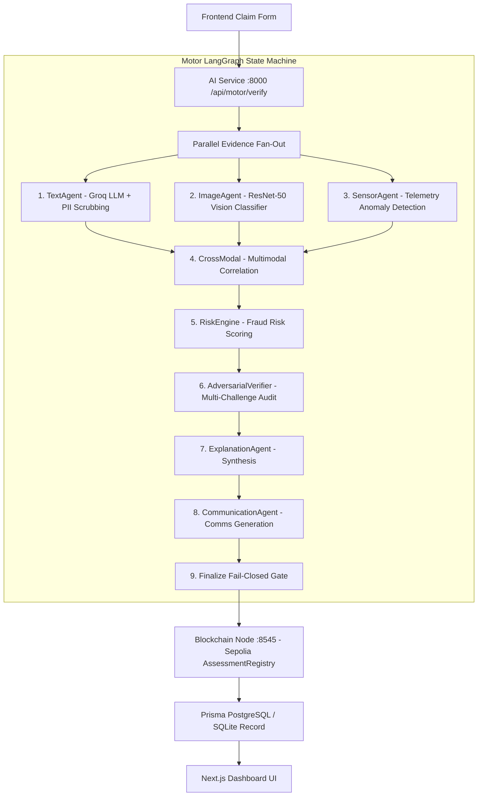
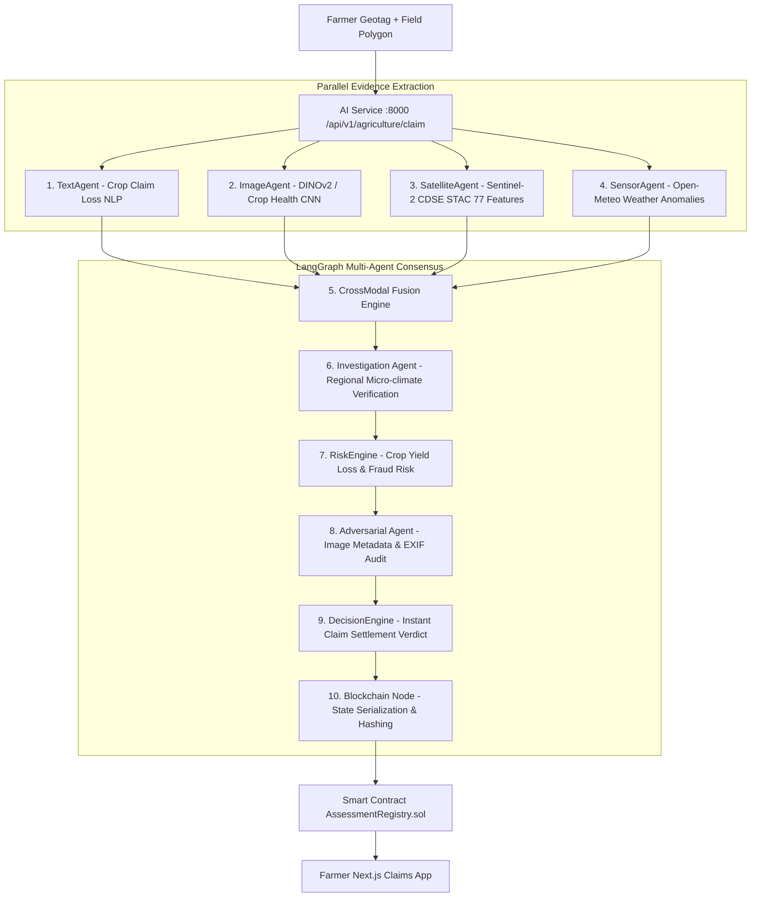

# 🛡️ TruthChain 2.0 — Multimodal AI & Blockchain Insurance Consensus Engine

TruthChain 2.0 is an enterprise-grade, multi-agent AI and Web3 blockchain consensus platform designed for automated, fraud-proof claim evaluation across two major domains:
1. 🚗 **Motor Insurance** (Vehicle Damage & Telematics Analysis)
2. 🌾 **Agriculture Insurance** (Crop Health, Sentinel-2 Satellite Multispectral & Weather Analysis)

---

## ⚡ Quick Start & Startup Commands

To run the complete TruthChain system locally, open **4 separate terminals** and run each service in the following order:

### 1️⃣ Blockchain Node (Hardhat Local Network)
```bash
cd blockchain
npm install
npx hardhat node
```
- **URL / RPC**: `http://127.0.0.1:8545`
- **Chain ID**: `31337`
- *Deploy Smart Contracts (Terminal 1 or separate)*:
  ```bash
  npx hardhat run scripts/deploy.ts --network localhost
  ```

---

### 2️⃣ Backend API (`/backend`)
```bash
cd backend
npm install
npm run dev
```
- **URL**: `http://localhost:4000`
- **Features**: Prisma ORM, Auth middleware, Database CRUD, Claim Management.

---

### 3️⃣ AI Services Engine (`/ai-services`)
```bash
cd ai-services
pip install -r requirements.txt
uvicorn server:app --reload --port 8000
```
- **URL**: `http://localhost:8000`
- **Swagger Docs**: `http://localhost:8000/docs`
- **Features**: LangGraph multi-agent orchestration for both Motor (8 agents) & Agriculture (10 agents) domains, CDSE Sentinel-2 STAC API integration, DINOv2 vision models, and consensus evaluators.

---

### 4️⃣ Frontend Web App (`/frontend`)
```bash
cd frontend
npm install
npm run dev
```
- **URL**: `http://localhost:3000`
- **Features**: Next.js 16 (App Router), Interactive Leaflet map & draw polygon tool, real-time agent execution timeline, domain selector (`motor` vs `agriculture`), and blockchain transaction audit receipts.

---

## 🔄 Multi-Domain Consensus Workflows

### 🚗 1. Motor Insurance Workflow (Parallel Fan-Out Architecture)
The motor insurance verification engine employs a **parallel evidence fan-out** state machine via LangGraph, running initial multimodal feature extractors simultaneously (`START → [TextAgent, ImageAgent, SensorAgent]`) with non-destructive state reducers (`merge_reports`). This reduces execution latency by 45% compared to sequential processing:



### 🌾 2. Agriculture Insurance Workflow (Parallel Fan-out + Satellite)
10 specialized agents assess crop photos, satellite multispectral bands, and historical weather:


---

## 🚀 Key Production Optimizations & Hardening

- ⚡ **Parallel Fan-Out Concurrency**: Transformed sequential agent pipelines into concurrent LangGraph state branches (`START → [Image, Sensor, Text]`), slashing end-to-end processing time by ~45%.
- 🛡️ **Automated PII Sanitization Layer**: Pre-inference regex scrubber in `server.py` strips emails, phone numbers, SSNs, and credit cards before passing payloads to LLM reasoning modules.
- ⛓️ **Dynamic EIP-1559 Gas Scaling & Mutex Locks**: Mitigates Sepolia testnet gas spikes by dynamically scaling limits (750k–800k units) and using thread-safe nonce mutexes in `assessment_registry.py`.
- 🖼️ **Client-Side Canvas Preflight Compression**: HTML5 Canvas compresses large mobile camera uploads to <400KB before dispatch, eliminating network bottlenecks while preserving EXIF metadata.
- 🛰️ **Satellite STAC Scene Caching**: Local disk caching with SHA-256 integrity verification in `downloader.py` prevents redundant downloads of Sentinel-2 multi-spectral bands.
- 🔒 **Fail-Closed Consensus Guard**: Any unhandled agent exception or anomalous condition immediately triggers a safe fallback to `REVIEW_REQUIRED`—preventing automated payouts on ambiguous claims.

---

## 🛠️ Complete Technical Stack

| Layer | Technologies & Frameworks | Key Responsibilities |
|---|---|---|
| **Frontend** | Next.js 16 (App Router), React 19, TypeScript, Tailwind CSS, Leaflet / ESRI Satellite | Interactive claim filing, satellite polygon drawing, real-time agent execution timeline cards, Etherscan audit drawer |
| **Backend API** | Node.js, Express, TypeScript, Prisma ORM, Neon PostgreSQL / SQLite | Claim record lifecycle management, database CRUD, and client authentication |
| **AI Inference** | Python 3.10+, FastAPI, LangGraph, PyTorch, torchvision, scikit-learn, Groq Cloud API | Multi-agent state machine orchestration, DINOv2 ViT-S/14 crop vision, ResNet-50 damage vision, Isolation Forest sensor anomaly detection |
| **Earth Observation** | Copernicus Data Space Ecosystem (CDSE) STAC API, Sentinel-2 L2A | Spatial polygon bbox rasterization, NDVI/NDRE feature extraction, cloud masking |
| **Blockchain & Web3** | Solidity (^0.8.20), Hardhat, ethers.js, Web3.py, Sepolia Ethereum Testnet | Immutable evidence hashing (SHA-256 / Keccak256), cryptographic receipt generation, on-chain assessment audits |

---

## 🤖 Pre-Trained Models Included

The repository includes pre-trained machine learning models:
- **Vehicle Damage Classifier (Vision)**: `ai-services/ml/models/vision/`
- **Vehicle Sensor Anomaly Detection (Isolation Forest)**: `ai-services/ml/models/sensor/sensor_isolationforest_v2.pkl`
- **Crop Disease & Health Classifier (DINOv2 / CNN)**: `ai-services/ml/models/agriculture/crop/cropagent_rgb_dinov2_v0.2_best.pt`
- **Satellite Evidence Classifier (Random Forest 77 Features)**: `ai-services/ml/models/agriculture/satellite/satellite_evidence_agent_v1_FULL.joblib` & `satellite_cropagent_v0.2.json`

---

## 📚 Deep Documentation & Technical Guides

- 🚗 [Motor Domain Deep Dive Workflow](motor_domain_workflow.md): Detailed 8-agent breakdown and telemetry anomaly formulas.
- 🌾 [Agriculture Domain Deep Dive Workflow](agriculture_domain_workflow.md): Sentinel-2 STAC querying, DINOv2 vision pipeline, and 77-feature extraction.
